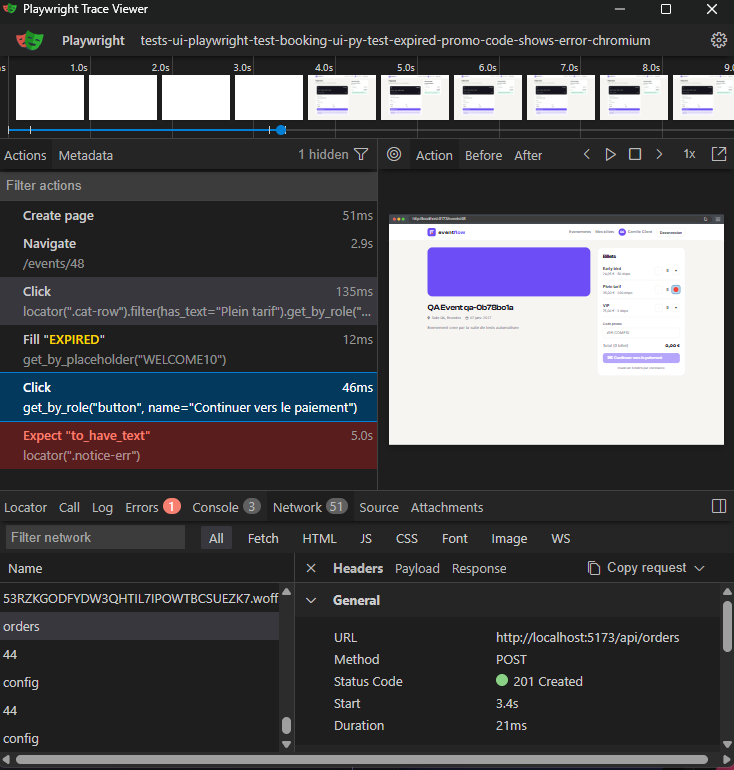

# A2 — Preuve du bug B4 (code promo expiré accepté)

## Règle métier concernée

RM4 : un code promo a une date d'expiration. Un code expiré doit être refusé
(API : **400 "Promo code expired"**, interface : message d'erreur affiché).

Backend en mode bug : `http://localhost:8000/api/config` renvoie `{"seed_bugs":true}`.

## 1. Le test UI

`qa/tests/ui/playwright/test_booking_ui.py:47-52`, `test_expired_promo_code_shows_error` :

1. ouvre la page d'un événement de test ;
2. ajoute 1 billet « Plein tarif » ;
3. saisit `EXPIRED` dans le champ code promo ;
4. clique sur « Continuer vers le paiement » ;
5. attend que le bloc `.notice-err` affiche « Promo code expired ».

Commande (depuis `qa/`, venv activé) :

```powershell
pytest tests/ui/playwright/test_booking_ui.py::test_expired_promo_code_shows_error -p no:rerunfailures
```

Sortie (identique aux 3 lancements) :

```text
E       AssertionError: Locator expected to have text 'Promo code expired'
E       Actual value: None
E       Error: element(s) not found
tests\ui\playwright\test_booking_ui.py:52: AssertionError
FAILED tests/ui/playwright/test_booking_ui.py::test_expired_promo_code_shows_error[chromium]
```

## 2. Fréquence

| Lancement | Résultat |
|---|---|
| 1 | FAILED (élément `.notice-err` introuvable) |
| 2 | FAILED (même erreur) |
| 3 | FAILED (même erreur) |

**3 échecs sur 3**, toujours au même endroit avec le même message. Ce n'est pas
un test instable (flaky) : un test instable passe parfois. Ici le produit est
cassé de façon reproductible.

## 3. Front ou back ? Le test API seul

```powershell
pytest "tests/api/test_booking_rules.py::test_rm4_promo_codes[EXPIRED]"
```

```text
E       AssertionError: {"id":21,"event_id":27,"status":"pending","total_cents":5950,...,"items":[{"category_id":80,"quantity":2,"unit_price_cents":3500}]}
E       assert 201 == 400
FAILED tests/api/test_booking_rules.py::test_rm4_promo_codes[EXPIRED]
```

- Statut attendu : **400**. Statut reçu : **201 Created**.
- Total : 2 × 3500 = 7000, facturé **5950**, donc la remise de 15 % du code expiré est appliquée.

**Conclusion : l'API accepte le code sans navigateur, donc le défaut est dans le back.**
Le front affiche simplement ce que l'API lui répond : comme l'API ne renvoie pas
d'erreur, il n'y a rien à afficher.

## 4. La trace Playwright

Commande (juste après un nouvel échec du test UI) :

```powershell
playwright show-trace reports/playwright/tests-ui-playwright-test-booking-ui-py-test-expired-promo-code-shows-error-chromium/trace.zip
```

Action « click » sur « Continuer vers le paiement », onglet **Network**, requête `POST /api/orders` :

| Élément | Valeur |
|---|---|
| Corps de la requête | `{"event_id":28,"items":[{"category_id":83,"quantity":1}],"promo_code":"EXPIRED"}` |
| Statut de la réponse | **201 Created** |
| `total_cents` | **2975** (prix Plein tarif 3500 − 15 % = 2975, la remise est appliquée) |
| Page suivante | `/events/28` → **`/checkout/22`** : l'utilisateur passe au paiement |
| Onglet Console | Aucune erreur (seulement les messages de Vite et React DevTools) |

L'en-tête `Authorization` (jeton) n'est volontairement pas recopié.

Capture (relance du test, événement 48 : même résultat, `POST /api/orders` → **201 Created**,
en-têtes de requête repliés pour ne pas montrer le jeton) :



## 5. Vérification en base (SQL)

```powershell
docker compose exec db psql -U eventflow -d eventflow -c "SELECT code, percent_off, expires_at FROM promo_codes WHERE code = 'EXPIRED';"
```

```text
  code   | percent_off |         expires_at
---------+-------------+----------------------------
 EXPIRED |          15 | 2026-11-22 10:35:36.623663
(1 row)
```

Le code a expiré le **22/11/2026 à 10:35**. Le test a tourné le **23/11/2026**
(`SELECT now()` : 2026-11-23 13:48 UTC). Il est donc bien périmé dans la base.

## 6. Code en cause

`backend/app/routers/orders.py:34`, fonction `_validate_promo` :

```python
if promo.expires_at and promo.expires_at < datetime.utcnow() and not settings.seed_bugs:
    # BUG B4 (fil rouge): quand active, l'API accepte un code promo expire.
    raise HTTPException(status_code=400, detail="Promo code expired")
```

Cette ligne devrait refuser `EXPIRED`. La condition `and not settings.seed_bugs`
la rend fausse dès que `SEED_BUGS=true` : l'exception n'est jamais levée, le code
passe et la remise s'applique.

## Conclusion

Le bug B4 est confirmé et localisé **côté back** (orders.py:34). Il échoue 3 fois
sur 3 : ce n'est pas un test instable, c'est un vrai défaut produit.
